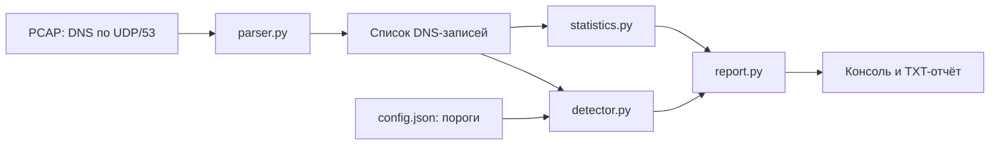

# DNS Security Analyzer

Учебный проект по «Алгоритмизации и программированию»: консольный анализатор DNS-трафика из файлов PCAP. Программа будет считать статистику и объяснять простые аномалии в сетевой активности.

**Этап: неделя 1 — подготовка репозитория.** Здесь находятся структура проекта, договорённости по интерфейсам и план работы. Анализатор пока не реализован; `main.py` намеренно пустой по заданию первой недели.

Период работы: **4 ноября — 19 декабря 2026 года**. Контроль — каждую субботу до **20:00 МСК**.

## Цель и границы MVP

Вход — заранее записанный `.pcap` с обычными DNS-запросами и ответами по **UDP/53**. Scapy используется для чтения и разбора пакетов; статистику, правила обнаружения и отчёт команда пишет самостоятельно.

Обязательный результат:

- количество DNS-запросов и уникальных запрошенных доменов;
- топ-10 доменов и распределение запросов по типам;
- количество ответов NXDOMAIN;
- три предупреждения: частые запросы клиента, длинное доменное имя, частые NXDOMAIN;
- понятный вывод в консоль и сохранение TXT-отчёта;
- обработка неверного пути, пустого или повреждённого PCAP и файла без DNS;
- воспроизводимые демонстрации нормального трафика, аномального трафика и ошибки ввода.

В MVP не входят DoH/DoT, обязательная поддержка DNS по TCP, онлайн-сниффинг, веб-интерфейс, нейросеть и собственный бинарный парсер PCAP. Предупреждения показывают необычное поведение и могут давать ложные срабатывания.

## Команда

| Участник | Ответственность | Основные файлы |
| --- | --- | --- |
| Кирилл — капитан | Модель данных, статистика, интеграция, документация и сроки | `statistics.py`, `main.py`, `README.md` |
| Стёпа | Чтение PCAP и извлечение DNS-полей | `parser.py`, `samples/` |
| Илья | Три правила обнаружения и тесты алгоритмов | `detector.py`, `tests/` |
| Миша | Консольный вывод, TXT-отчёт, ошибки и сценарии демо | `report.py`, `tests/` |

Приглашения в репозиторий Кирилл отправит отдельно. Участники добавляют собственные реализации и проверки через Pull Request.

## Архитектура



`main.py` будет загружать настройки и вызывать модули по порядку. Внутренний формат данных, сигнатуры функций и точные границы порогов описаны в [контракте MVP](docs/contract.md).

## Структура репозитория

```text
.
├── main.py                       # пустая точка входа: задание недели 1
├── parser.py                     # место для парсера Стёпы
├── statistics.py                 # место для статистики Кирилла
├── detector.py                   # место для детектора Ильи
├── report.py                     # место для отчётов Миши
├── config.json                   # стартовые пороги MVP
├── requirements.txt              # зависимости Python
├── README.md
├── CONTRIBUTING.md               # ветки, PR, ревью и критерий готовности
├── .gitignore
├── .github/
│   └── pull_request_template.md
├── docs/
│   ├── contract.md               # модель данных и интерфейсы
│   └── week-01.md                # результаты и открытые задачи недели 1
├── samples/
│   └── README.md                 # правила для демонстрационных PCAP
├── tests/
│   └── README.md                 # план проверок модулей
└── DNS_Security_Analyzer_Team_Plan.pdf
```

Файлы модулей пока содержат только описание будущей ответственности. PCAP-примеры и автоматические тесты ещё предстоит добавить.

## Подготовка окружения

Рабочая версия Python для команды — **3.11 или новее**. Единственная внешняя зависимость на старте — [Scapy](https://pypi.org/project/scapy/); её версия закреплена в `requirements.txt`.

```bash
git clone https://github.com/MaimeD666/DNS-Security-Analyzer.git
cd DNS-Security-Analyzer
python -m venv .venv
```

Если команда `python` отсутствует, используй `python3` для создания окружения.

Активация на macOS / Linux:

```bash
source .venv/bin/activate
```

Активация в Windows PowerShell:

```powershell
.venv\Scripts\Activate.ps1
```

После активации:

```bash
python -m pip install -r requirements.txt
python -c "import scapy; print(scapy.__version__)"
python main.py
```

На первой неделе последняя команда завершается без вывода: точка входа пустая. Она проверяет только наличие файла и окружения, а не работу анализатора.

Планируемый запуск после интеграции на неделях 3–4:

```bash
python main.py samples/normal.pcap
```

Эта команда пока не анализирует трафик, а `normal.pcap` ещё не добавлен. Интерфейс выбора TXT-файла уточним при реализации `main.py` и `report.py`.

## Стартовые пороги

| Правило | Срабатывание | Что учитываем |
| --- | --- | --- |
| Частые запросы | Более 100 за 60 секунд от одного клиента | Только запросы |
| Длинный домен | Более 80 символов | Нормализованное имя в запросе |
| Частые NXDOMAIN | Более 20 за 60 секунд для одного клиента | Только ответы с `rcode=3` |

Значения хранятся в [config.json](config.json). Это учебные настройки, а не доказательство атаки. Контракт и пороги зафиксированы как рабочая версия капитана для обсуждения до **7 ноября**; согласование всеми участниками ещё не отмечено.

## План по неделям

| Дедлайн, 2026 год | Результат команды |
| --- | --- |
| **7 ноября** | Репозиторий, контракт, пороги, первый код каждого участника — [чек-лист](docs/week-01.md) |
| **14 ноября** | Независимые модули работают на известных данных; есть проверки |
| **21 ноября** | Первый общий путь PCAP → статистика → предупреждения → отчёт |
| **28 ноября** | Стабильный MVP и два воспроизводимых PCAP-сценария |
| **5 декабря** | Граничные тесты, понятные ошибки, проверка установки с нуля |
| **12 декабря** | Документация, репетиция защиты и тег `v1.0-rc` |
| **19 декабря** | Исправление замечаний, релиз `v1.0` и финальная сдача |

Личные результаты по всем неделям и план защиты находятся в [исходном командном плане](DNS_Security_Analyzer_Team_Plan.pdf). Это рабочий документ; соответствие требованиям преподавателя нужно сверить отдельно.

## Как работать вместе

Работаем в ветках `feature/parser`, `feature/detector`, `feature/report`, `feature/statistics` или в коротких ветках под конкретную задачу. В `main` попадает проверенная версия после PR и просмотра хотя бы одним другим участником.

Подробные команды и правила — в [CONTRIBUTING.md](CONTRIBUTING.md). Задача готова, когда код опубликован на GitHub, запускается, имеет способ проверки и автор может объяснить реализацию.

Каждую субботу до 20:00 МСК каждый отправляет в командный чат ссылку на свой PR/коммит, что работает, как проверить и что мешает завершить задачу. При необходимости воскресенье используем для интеграции и исправлений.
